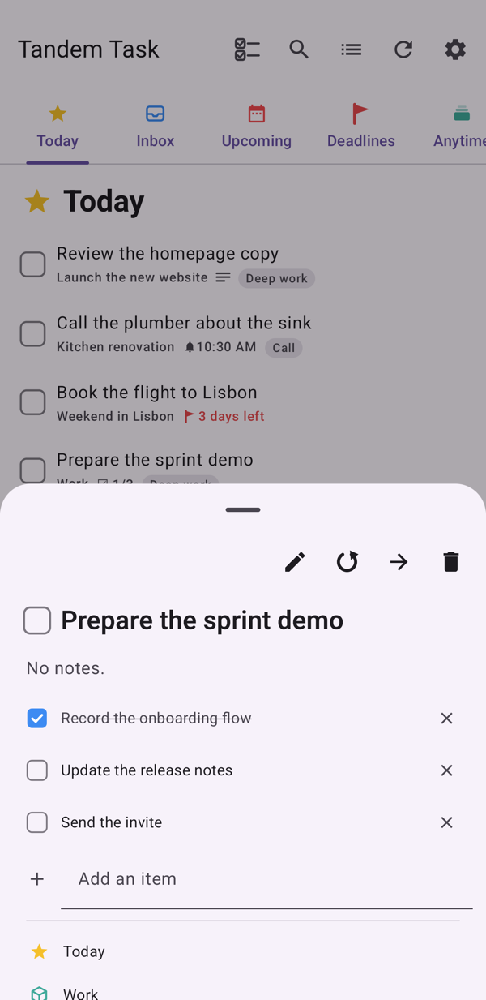
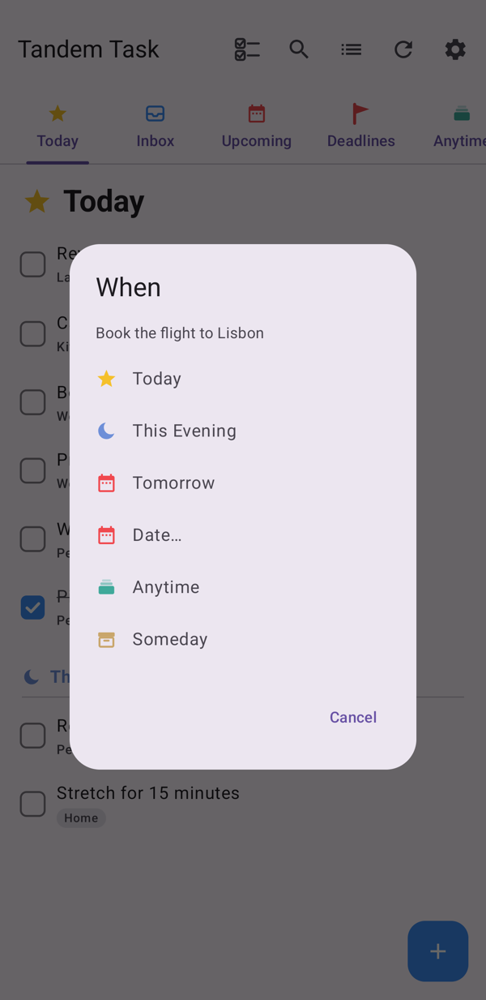
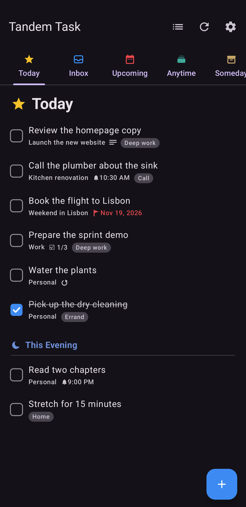
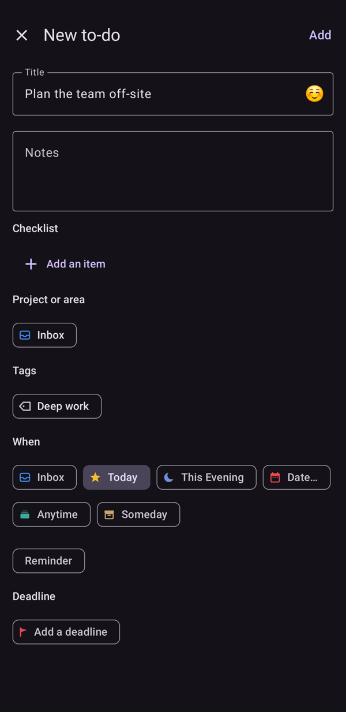
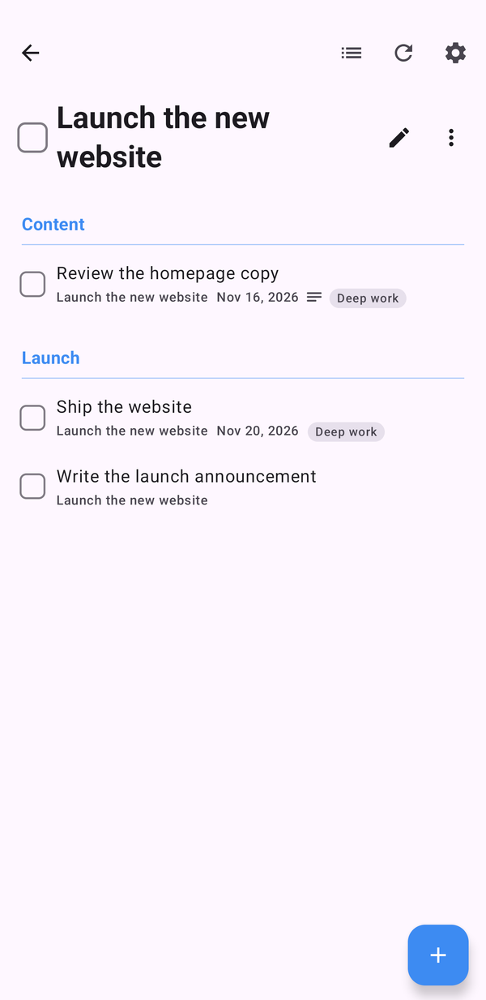
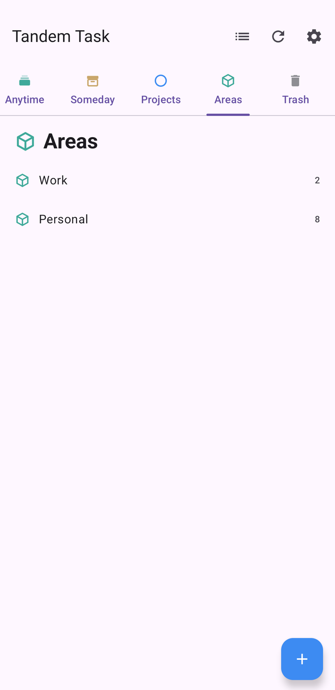
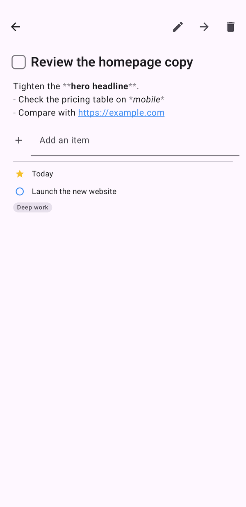

<p align="center">
  
</p>

# Tandem Task

**An unofficial Android companion for [Things 3](https://culturedcode.com/things/).**
Things has no Android app. Tandem Task brings your lists, notes and reminders to your Android phone, and keeps them in sync with your Mac, iPhone and iPad through Things Cloud.

> [!IMPORTANT]
> Tandem Task is a personal, open-source project. It is **not affiliated with, endorsed by, or supported by Cultured Code**.
> Things Cloud has no public API: the app uses a reverse-engineered protocol that may stop working at any time.
> Writes go to your real Things data. Use it at your own risk and keep a backup.

## Features

- **Your lists**: Today (with This Evening and what is due), Inbox, Upcoming (grouped by day, deadlines included), Deadlines (overdue first, then by day), Anytime, Someday, Projects (grouped by area, each area folding open or closed) and Trash, with notes, checklists, tags, deadlines and repeat rules. Projects show their to-dos under their headings.
- **Search**: pull a list down, or tap the magnifier, to find to-dos, projects and areas by title or notes, and lists by name.
- **Your tabs, your order**: in Settings, reorder the lists and hide the ones you don't use; hidden lists stay one search away.
- **Works offline, never waits**: every change shows at once. Changes are kept on the phone and sent in the background a few seconds after your last tap, or later when the network comes back.
- **Swipe actions**: swipe a to-do left to reschedule (Today, This Evening, Tomorrow, a date, Anytime, Someday), repeating ones included, swipe right past halfway to move it to the Trash (a short swipe slides back), with Undo. Projects, headings and areas are deleted the same way.
- **Select several**: pick to-dos or projects, then reschedule, move, check off or trash them at once.
- **Tags**: tag to-dos and projects with your Things tags, also right when you create them.
- **Drag to reorder**: long-press a to-do, a heading or a project and drag it, also into This Evening, under another heading or into another area.
- **Add and edit to-dos**: title (with an emoji in front if you like), notes, checklist items, when, reminder and deadline, the project or area right when you add it, and move them to the Inbox, a project, a heading or an area. Make a dated to-do repeat every N days, weeks, months or years, on a fixed schedule (weekly on chosen days; monthly or yearly on its day, its weekday's rank or the last day) or after completion, and check such to-dos off the way Things does it, so the next one comes on the right day; other repeats stay protected the way Things expects.
- **Projects and areas**: each project's circle fills as its to-dos get done. Tap **+** to add a to-do, or long-press it for a heading. Create projects (with when and deadline), headings and areas; rename, complete, cancel, reopen, move and delete them. Completing a project completes its open to-dos, as in Things.
- **Markdown in notes**: bold, italic, strikethrough, code, headings, lists and links, styled while you read and while you type.
- **To-do details**: a tap slides the to-do up in a sheet; tap its When, project or tags to change them. A long press on a checkbox cancels the to-do, as in Things.
- **Checklists**: check items from the to-do, add, rename or delete them.
- **Trash**: move to-dos to the Trash, restore them, or delete them for good (one at a time or Empty Trash), after a confirmation.
- **Reminders on Android**: reminders set on any device ring on your phone as notifications, on time.
- **Home-screen widget**: any list or project. Tap a circle to check a to-do off (it stays ticked for 3 seconds, so a second tap takes a mistake back), or **+** to add one. Reminders and deadlines stand out under each title. The ⋯ button changes the list, the theme (light, dark or system), the background color and its opacity.
- **Filters**: by tag, project or area, and date. Show or hide to-dos completed today.
- **Background sync** every 30 minutes and when you come back to the app, so the widget stays current.
- A design in the spirit of Things. Light, dark or system theme. English and French.

## What works with Things

Every change below is written to Things Cloud the way Things 3 writes it, so it shows on your Mac, iPhone and iPad.

| Things | In Tandem Task |
|---|---|
| Inbox, Today, This Evening, Upcoming, Anytime, Someday, Trash | Read and write; to-dos closed today stay struck through, as in Things |
| Deadlines list | Read; overdue first, then by deadline day; undated to-dos due today or earlier also show in Today |
| To-dos | Create, edit title and notes, When, reminder, deadline, checklist, tags, move, complete, cancel, reopen, trash, restore, delete for good |
| Projects | Create, edit, When and deadline, tags, move to an area, complete, cancel, reopen, delete; progress circle |
| Headings | Create, rename, reorder, delete |
| Areas | Create, rename, delete (its projects and to-dos go to the Trash with it, as in Things) |
| Tags | Add or remove Things' tags on to-dos and projects, also when creating them |
| Repeating to-dos | Make a to-do repeat (days, weeks, months, years; fixed or after completion), check it off, swipe an occurrence to another day or to the Trash |
| Reminders | Ring on the phone as notifications |
| Order | Drag to-dos, headings and projects, Today and This Evening included |
| Quick Find | Search to-dos, projects, areas and lists |
| Not yet | The Logbook, creating or renaming tags, changing or stopping a repeat rule, making a to-do with a deadline repeat |

See the [changelog](CHANGELOG.md) for what changed in each version.

## Screenshots

| Today | To-do with checklist | Swipe left to reschedule |
|:---:|:---:|:---:|
|  |  |  |

| Dark mode | Upcoming | New to-do |
|:---:|:---:|:---:|
|  |  |  |

| Project with headings | Areas | Markdown in notes |
|:---:|:---:|:---:|
|  |  |  |

<p align="center"></p>

## Install

1. Download the latest `tandem-task-*.apk` from [Releases](../../releases).
2. Open it on your phone and allow installing apps from this source when Android asks.
3. Sign in with your Things Cloud email and password, then allow notifications for reminders.

Requires Android 8.0 or later and a Things Cloud account.

## Privacy and security

- Your password is used once to sign in and is **never stored**. The app keeps only the Things Cloud history key, encrypted with a key held by the Android Keystore.
- Your to-dos are cached on the phone, in the app's private storage, so lists open instantly and work offline for reading.
- The app talks only to `cloud.culturedcode.com`. No analytics, no third-party servers.

## How it works

Things Cloud stores an append-only history of changes. Tandem Task pulls that history, replays it into the current state of your to-dos, and pulls only new items afterwards. Writes (add, edit, check off) are small commits on top of the server's latest state, and the app reports success only after reading the change back.

The project is split in two modules:

- `thingscloud/`: pure Kotlin. The Things Cloud client, the history replay, the list rules and the write use cases. Fully unit-tested on the JVM.
- `app/`: the Android app (Jetpack Compose), the widget (Glance), background sync (WorkManager) and reminder notifications.

## Build from source

Requires JDK 17 and the Android SDK (platform 35). Create `local.properties` with `sdk.dir=/path/to/android/sdk`, then:

```sh
./gradlew test                 # unit tests
./gradlew :app:assembleDebug   # app/build/outputs/apk/debug/app-debug.apk
```

Demo mode (sample data, no network, nothing written), used for the screenshots:

```sh
adb shell am start -n dev.thingscompanion.app/.MainActivity --ez demo true
```

## Credits

The Things Cloud protocol handling started as a port of [things3-cloud](https://github.com/evanpurkhiser/things3-cloud) by Evan Purkhiser (MIT). See [THIRD_PARTY_NOTICES.md](THIRD_PARTY_NOTICES.md).

Things and Things 3 are trademarks of Cultured Code GmbH & Co. KG.

## License

[MIT](LICENSE)
