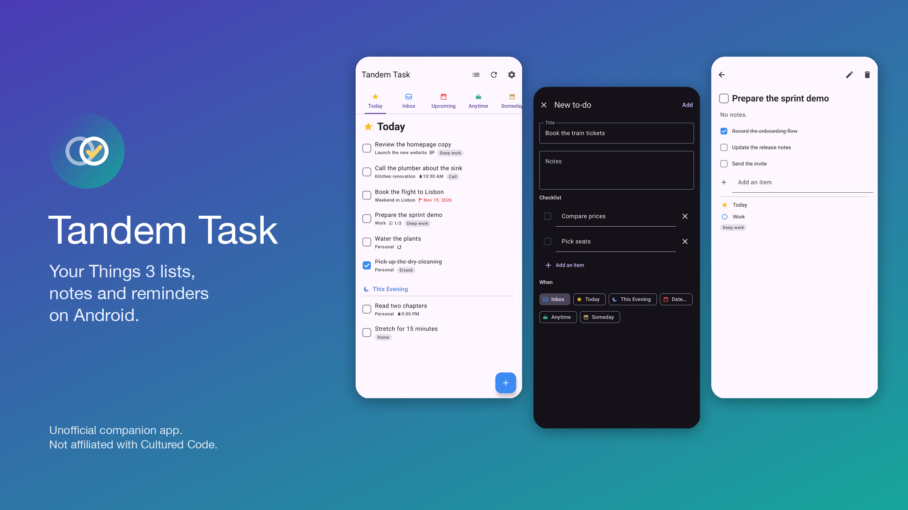
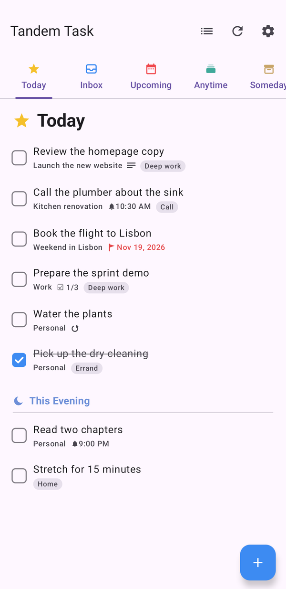
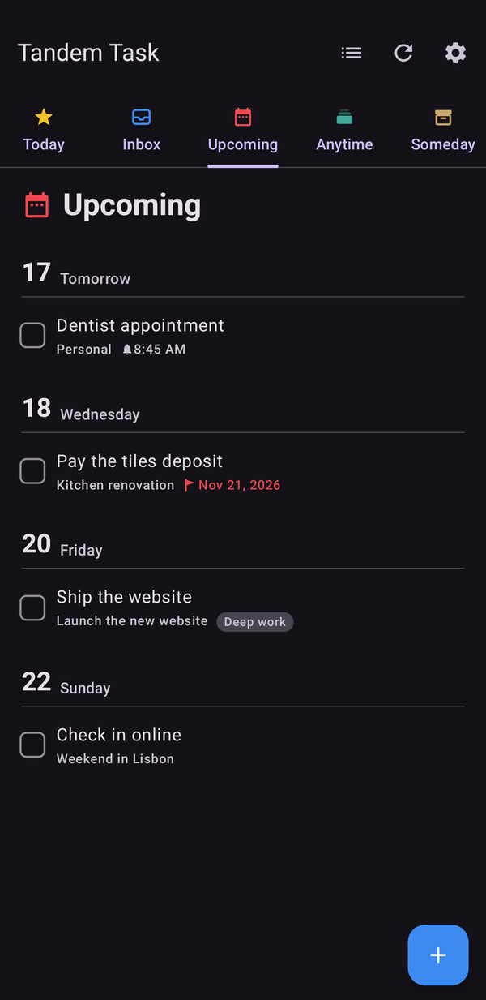
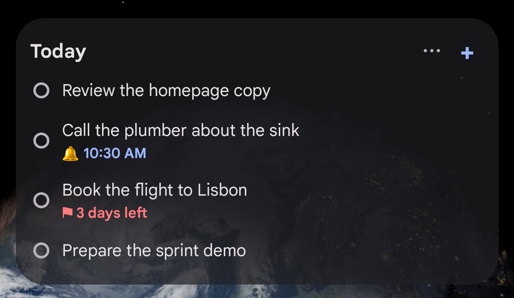

<p align="center">
  
</p>

# Tandem Task

**An unofficial Android companion for [Things 3](https://culturedcode.com/things/).**
Things has no Android app. Tandem Task brings your lists, notes and reminders to your Android phone, and keeps them in sync with your Mac, iPhone and iPad through Things Cloud.

> [!IMPORTANT]
> Tandem Task is a personal, open-source project. It is **not affiliated with, endorsed by, or supported by Cultured Code**.
> Things Cloud has no public API: the app uses a reverse-engineered protocol that may stop working at any time.
> Writes go to your real Things data. Use it at your own risk and keep a backup.

## Features

- **Your lists**: Today (with This Evening), Inbox, Upcoming (grouped by day), Anytime, Someday, Projects (grouped by area) and Trash, with notes, checklists, tags, deadlines and repeat rules.
- **Works offline, never waits**: adding, editing, checking off or moving a to-do shows at once. Changes are kept on the phone and sent in the background, even later when the network comes back.
- **Swipe actions**: swipe left to reschedule (Today, This Evening, Tomorrow, a date, Anytime, Someday), swipe right to move to the Trash, with Undo.
- **Add and edit to-dos**: title, notes, checklist items, when and reminder. Repeating to-dos stay protected the way Things expects.
- **Checklists**: check items from the to-do, add, rename or delete them.
- **Trash**: move to-dos to the Trash and restore them.
- **Reminders on Android**: reminders set on any device ring on your phone as notifications, on time.
- **Home-screen widget**: any list or project, with a **+** to add a to-do. Light, dark or system theme, adjustable background opacity.
- **Filters**: by tag, project or area, and date. Show or hide to-dos completed today.
- **Background sync** every 30 minutes and when you come back to the app, so the widget stays current.
- A design in the spirit of Things. Light, dark or system theme. English and French.

See the [changelog](CHANGELOG.md) for what changed in each version.

## Screenshots

| Today | To-do with checklist | Swipe left to reschedule |
|:---:|:---:|:---:|
|  |  |  |

| Dark mode | Upcoming | New to-do |
|:---:|:---:|:---:|
|  |  |  |

<p align="center"></p>

## Install

1. Download the latest `tandem-task-*.apk` from [Releases](../../releases).
2. Open it on your phone and allow installing apps from this source when Android asks.
3. Sign in with your Things Cloud email and password, then allow notifications for reminders.

Requires Android 8.0 or later and a Things Cloud account.

## Privacy and security

- Your password is used once to sign in and is **never stored**. The app keeps only the Things Cloud history key, encrypted with a key held by the Android Keystore.
- Your to-dos are cached on the phone, in the app's private storage, so lists open instantly and work offline for reading.
- The app talks only to `cloud.culturedcode.com`. No analytics, no third-party servers.

## How it works

Things Cloud stores an append-only history of changes. Tandem Task pulls that history, replays it into the current state of your to-dos, and pulls only new items afterwards. Writes (add, edit, check off) are small commits on top of the server's latest state, and the app reports success only after reading the change back.

The project is split in two modules:

- `thingscloud/`: pure Kotlin. The Things Cloud client, the history replay, the list rules and the write use cases. Fully unit-tested on the JVM.
- `app/`: the Android app (Jetpack Compose), the widget (Glance), background sync (WorkManager) and reminder notifications.

## Build from source

Requires JDK 17 and the Android SDK (platform 35). Create `local.properties` with `sdk.dir=/path/to/android/sdk`, then:

```sh
./gradlew test                 # unit tests
./gradlew :app:assembleDebug   # app/build/outputs/apk/debug/app-debug.apk
```

Demo mode (sample data, no network, nothing written), used for the screenshots:

```sh
adb shell am start -n dev.thingscompanion.app/.MainActivity --ez demo true
```

## Credits

The Things Cloud protocol handling started as a port of [things3-cloud](https://github.com/evanpurkhiser/things3-cloud) by Evan Purkhiser (MIT). See [THIRD_PARTY_NOTICES.md](THIRD_PARTY_NOTICES.md).

Things and Things 3 are trademarks of Cultured Code GmbH & Co. KG.

## License

[MIT](LICENSE)
